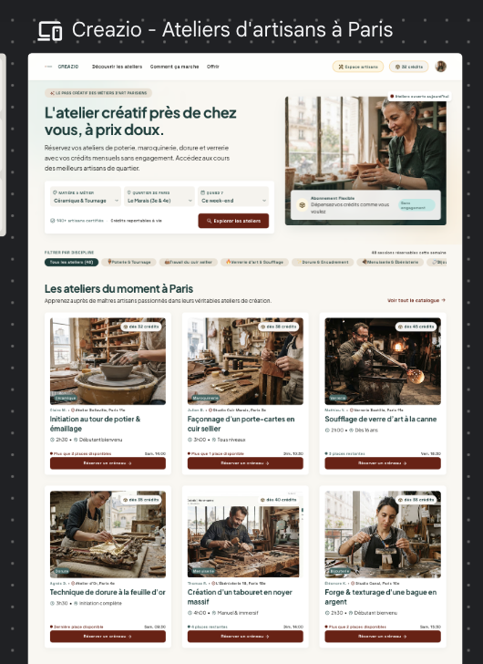
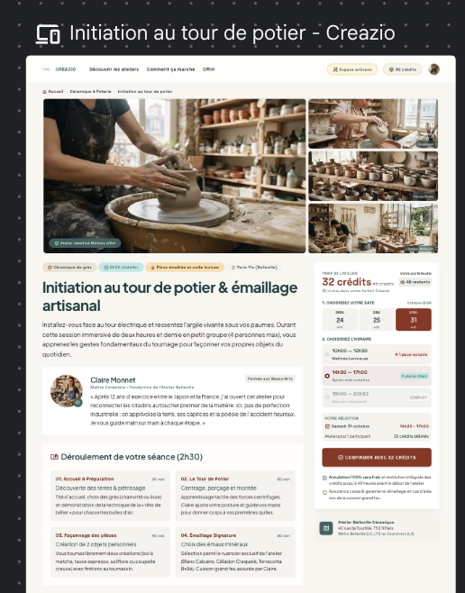

# Maquettes Stitch — Creazio

Export du projet Google Stitch, archivé le 25 octobre 2026 (livrable n° 4 du jury RNCP, compétences C8 et C9).

Le premier projet Stitch (maquettes du 11 octobre) a disparu de Stitch, encore en version bêta. Il a été recréé le 25 octobre à partir de captures de l'application et du design system « Atelier Forest & Terracotta », puis exporté et archivé ici pour qu'il ne puisse plus être perdu.

## Aperçu des écrans

### Landing page élève

### Fiche atelier

### Dashboard artisan « Mes revenus »
Voir `ecran-3-mes-revenus/code.html` (à ouvrir dans un navigateur).

## Contenu

| Dossier ou fichier | Contenu |
|---|---|
| `ecran-1-landing/code.html` | Landing page élève |
| `ecran-2-fiche-atelier/` | Fiche atelier avec ses créneaux et le bloc de réservation (`code.html` + aperçu `screen.png`) |
| `ecran-3-mes-revenus/code.html` | Dashboard artisan « Mes revenus » |
| `DESIGN.md`, `design-system-stitch.md` | Design system tel qu'importé dans Stitch (la référence reste `docs/design-system.md`) |
| `audits/` | Audits d'accessibilité WCAG 2.1 / 2.2 générés par Stitch |

Pour voir un écran : ouvrir le fichier `code.html` dans un navigateur.

## Résultats des audits

- **Contraste : 100 % conforme AA et AAA** sur la landing et sur « Mes revenus » (texte principal 11,92:1, boutons Terracotta Cuit #8F3222 7,93:1, prix barré 6,35:1).
- Conformité globale estimée : 85 %. Les écarts portent sur la navigation clavier et les lecteurs d'écran ; seuls ceux qui existent réellement dans l'application ont été corrigés dans le code.

Les maquettes ont servi à explorer et valider le design system et les contrastes. L'application a ensuite évolué au fil des tests : elle fait foi (audit Lighthouse du site en production : accessibilité 98/100).
